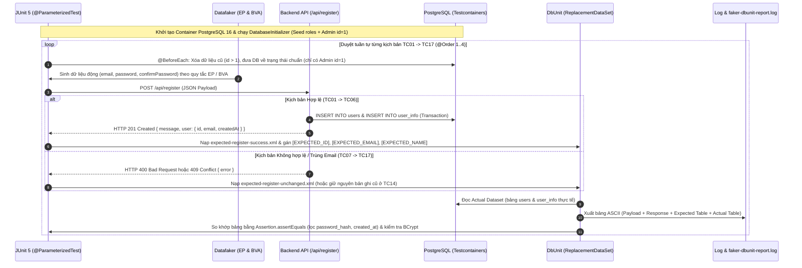

# Hướng Dẫn Thực Thi Kiểm Thử & Luồng Kiểm Thử Tự Động (Backend Test Suite)

Tài liệu này hướng dẫn cách chạy các bộ kiểm thử tự động trong thư mục `backend/src/test` và giải thích chi tiết **luồng thực thi kiểm thử tích hợp** kết hợp **Datafaker + Spring Boot (`TestRestTemplate`) + Testcontainers (PostgreSQL) + DbUnit**.

---

## 1. Cấu Trúc Thư Mục Test

```text
backend/src/test/
├── README.md                                                  # Tài liệu hướng dẫn thực thi & luồng kiểm thử
├── java/com/demo/
│   ├── auth/                                                  # Kiểm thử tích hợp qua Backend REST API + DbUnit
│   │   ├── AbstractDbUnitTestSupport.java                     # Lớp cơ sở dùng chung cho các test DbUnit (hỗ trợ JSONB)
│   │   ├── FR_Register_Test.java                              # Kiểm thử FR-01 (EP & BVA: TC01 -> TC17) kế thừa lớp cơ sở
│   │   ├── demo_testcontainer/                                # Nhóm kịch bản demo/kiểm tra kết nối Testcontainers cơ bản
│   │   │   └── PostgreSqlContainerSmokeTest.java              # Smoke test kiểm tra khởi tạo container PostgreSQL & SELECT 1
│   │   └── demo_dbunit/                                       # Nhóm 4 kịch bản trình diễn tính năng & điểm yếu của DbUnit qua API
│   │       ├── DbUnitDemo01SetupAndSeedingTest.java           # Demo 01: Cài đặt kết nối & Nạp dữ liệu mẫu (Data Seeding)
│   │       ├── DbUnitDemo02BasicCrudVerificationTest.java     # Demo 02: Kiểm thử CRUD cơ bản (Faker -> API -> DbUnit)
│   │       ├── DbUnitDemo03ComplexBusinessFlowTest.java       # Demo 03: Luồng nghiệp vụ đa tác nhân & Phân quyền RBAC
│   │       └── DbUnitDemo04LimitationsAndWeaknessesTest.java  # Demo 04: Minh họa 4 điểm yếu thực tế của DbUnit & Cách xử lý
│   └── database_unit_testing/                                 # Kiểm thử đơn vị tầng Database thuần (Flyway + JDBC + DbUnit + Datafaker)
│       ├── T1MigrationTest.java                               # T1: Kiểm thử lược đồ CSDL (bảng, khóa ngoại, index) sau Flyway migrate
│       ├── T2DBUnitTest.java                                  # T2: Nạp dữ liệu tĩnh XML (CLEAN_INSERT) & đối chiếu bảng với DbUnit
│       ├── T3CRUDTest.java                                    # T3: Kiểm thử thao tác SQL CRUD trực tiếp & chuỗi thao tác tuần tự
│       ├── T4CheckPointTest.java                              # T4: Kiểm thử Multi-Checkpoint qua 4 bảng có ràng buộc khóa ngoại
│       └── T5DatafakerTest.java                               # T5: Sinh dữ liệu ngẫu nhiên với Datafaker & tạo ITable kỳ vọng động
└── resources/
    ├── db/migration/
    │   └── V1__auth_schema.sql                                # Script Flyway tạo schema cho nhóm database_unit_testing (T1 -> T5)
    └── datasets/
        ├── expected-register-success.xml                      # Dataset của FR_Register_Test (201 Created)
        ├── expected-register-unchanged.xml                    # Dataset của FR_Register_Test (400 Bad Request)
        ├── empty.xml                                          # Dataset rỗng dùng để dọn sạch 4 bảng trong T3, T4, T5
        ├── T2/, T3/, T4/                                      # Các thư mục chứa Dataset XML kỳ vọng cho T2, T3, T4
        └── demo_dbunit/                                       # Thư mục chứa Dataset XML riêng cho nhóm demo_dbunit
            ├── demo01-seed-users.xml                          # Seed 2 người dùng mẫu bằng DatabaseOperation.REFRESH
            ├── expected-register.xml                          # Dataset kỳ vọng khi đăng ký mới (Demo 02)
            ├── expected-profile-update.xml                    # Dataset kỳ vọng khi cập nhật hồ sơ (Demo 02)
            ├── demo03-expected-complex-flow.xml               # Dataset kỳ vọng cho luồng đa tác nhân (Demo 03)
            ├── demo04-column-sensing-trap.xml                 # Dataset minh họa bẫy Column Sensing (Demo 04)
            └── demo05-data-driven-cases.xml                   # Dataset mẫu cho kịch bản Data-Driven
```

---

## 2. Hướng Dẫn Thực Thi Test

### 2.1. Yêu cầu trước khi chạy
1. **Java JDK 27+** và **Maven** đã được cài đặt trong `PATH`.
2. **Docker Desktop** phải đang mở và ở trạng thái hoạt động (`Running`).
   > *Lưu ý:* Bạn **không** cần chạy `docker compose up` thủ công. **Testcontainers** sẽ tự động khởi tạo container `postgres:16-alpine` riêng biệt cho quá trình test và tự động xóa container đó sau khi chạy xong.

### 2.2. Các lệnh chạy kiểm thử (chạy từ thư mục gốc `Demo/`)

* **Chạy toàn bộ các lớp kiểm thử trong dự án:**
  ```powershell
  mvn -f backend\pom.xml test
  ```

* **Chạy riêng bộ kiểm thử Đăng ký EP & BVA với Datafaker & DbUnit (`TC01` → `TC17`):**
  ```powershell
  mvn -f backend\pom.xml -Dtest=FR_Register_Test test
  ```

* **Chạy riêng nhóm 4 kịch bản Demo DbUnit trong thư mục `demo_dbunit`:**
  ```powershell
  mvn -f backend\pom.xml "-Dtest=com.demo.auth.demo_dbunit.*Test" test
  ```

* **Chạy riêng nhóm 5 kịch bản Database Unit Testing (`T1` → `T5`) trong thư mục `database_unit_testing`:**
  ```powershell
  mvn -f backend\pom.xml "-Dtest=com.demo.database_unit_testing.*Test" test
  ```

### 2.3. Xem báo cáo dữ liệu Faker và bảng Database sau khi chạy test
Vì Testcontainers tự động dọn dẹp container PostgreSQL ngay khi test kết thúc, lớp `FR_Register_Test` đã tự động chụp (snapshot) và xuất toàn bộ dữ liệu của 17 kịch bản (`TC01` → `TC17`) ra 2 nơi:
1. **Console Log** trên màn hình terminal khi chạy lệnh Maven.
2. **Tệp báo cáo UTF-8 cố định** tại:
   ```text
   backend/target/faker-dbunit-report.log
   ```
   Mở tệp này để xem chi tiết từng kịch bản gồm:
   - `[1] DỮ LIỆU FAKER TẠO RA (REQUEST PAYLOAD)`
   - `[2] KẾT QUẢ PHẢN HỒI TỪ BACKEND (HTTP RESPONSE)`
   - `[3] BẢNG MONG ĐỢI ĐỘNG DBUNIT (EXPECTED DATASET)`
   - `[4] BẢNG THỰC TẾ TRONG POSTGRESQL (ACTUAL DATABASE)`

---

## 3. Luồng Thực Thi Kiểm Thử (`FR_Register_Test`)

### 3.1. Sơ đồ luồng tổng thể



### 3.2. Giải thích chi tiết 6 bước trong luồng thực thi

1. **Khởi tạo hạ tầng cô lập với Testcontainers:**
   - Khi lớp test bắt đầu, `@Container PostgreSQLContainer<?>` dựng một container `postgres:16-alpine`.
   - `DatabaseInitializer` tự động chạy để khởi tạo 4 bảng (`users`, `roles`, `user_info`, `edit_history`), nạp 2 vai trò (`user` với `role_id = 1`, `admin` với `role_id = 2`) và tạo sẵn tài khoản Admin đầu tiên (`id = 1`, `email = admin@example.com`).
2. **Thiết lập trạng thái sạch trước mỗi kịch bản (`@BeforeEach`):**
   - Đưa DB về đúng trạng thái chuẩn ban đầu (chỉ giữ lại tài khoản Admin `id = 1`) và khởi tạo kết nối `IDatabaseConnection` của DbUnit.
3. **Sinh dữ liệu đầu vào động bằng Datafaker (Áp dụng EP & BVA):**
   - Dùng `faker.internet().emailAddress()` và `faker.regexify(...)` để sinh dữ liệu ngẫu nhiên nhưng vẫn tuân thủ chặt chẽ từng phân vùng tương đương (**EP**) và giá trị biên (**BVA**).
4. **Gửi Request đến Backend API & Kiểm tra HTTP Response:**
   - Dùng `TestRestTemplate` gửi request tới máy chủ Spring Boot nhúng và kiểm tra HTTP Status (`201`, `400`, `409`).
5. **Tạo Bảng Kết Quả Mong Đợi Động (Dynamic Expected Dataset) trong DbUnit:**
   - Dùng `ReplacementDataSet` nạp tệp mẫu XML và thay thế các placeholder (`[EXPECTED_ID]`, `[EXPECTED_EMAIL]`, `[EXPECTED_NAME]`, `[EXPECTED_ROLE_ID]`, `[NULL]`) ngay tại runtime.
6. **Ghi Log Báo Cáo & Đối Chiếu Trạng Thái Database bằng DbUnit:**
   - Xuất bảng ASCII ra console và `backend/target/faker-dbunit-report.log`.
   - Lọc bỏ các cột không tiền định (`password_hash`, `created_at`) bằng `DefaultColumnFilter.excludedColumnsTable`, kiểm tra riêng `BCryptPasswordEncoder.matches` và gọi `Assertion.assertEquals` trên các bảng `users`, `user_info`, `edit_history`.

---

## 4. Danh Sách 17 Kịch Bản Kiểm Thử FR-01 (`TC01` → `TC17`)

| Thứ tự | Mã TC | Kỹ thuật | Mô tả kịch bản | HTTP Status | Số dòng trong DB (`users` & `user_info`) |
| :---: | :--- | :--- | :--- | :---: | :--- |
| 1 | **TC01** | EP Valid | Đăng ký hợp lệ tiêu chuẩn (mật khẩu 12 ký tự) | `201` | 2 dòng (Admin + User mới) |
| 2 | **TC02** | EP Valid | Email có khoảng trắng 2 đầu và chữ in HOA | `201` | 2 dòng (Email được `trim` + `lowercase`) |
| 3 | **TC03** | BVA Valid | Mật khẩu tại biên dưới `Min = 8` ký tự | `201` | 2 dòng (Admin + User mới) |
| 4 | **TC04** | BVA Valid | Mật khẩu ngay trên biên dưới `Min + 1 = 9` ký tự | `201` | 2 dòng (Admin + User mới) |
| 5 | **TC05** | BVA Valid | Mật khẩu ngay dưới biên trên `Max - 1 = 31` ký tự | `201` | 2 dòng (Admin + User mới) |
| 6 | **TC06** | BVA Valid | Mật khẩu tại biên trên `Max = 32` ký tự | `201` | 2 dòng (Admin + User mới) |
| 7 | **TC07** | BVA Invalid | Mật khẩu dưới biên tối thiểu `Min - 1 = 7` ký tự | `400` | 1 dòng (Chỉ có Admin, DB không đổi) |
| 8 | **TC08** | BVA Invalid | Mật khẩu vượt biên tối đa `Max + 1 = 33` ký tự | `400` | 1 dòng (Chỉ có Admin, DB không đổi) |
| 9 | **TC09** | EP Invalid | Mật khẩu thiếu chữ cái in hoa (`A-Z`) | `400` | 1 dòng (Chỉ có Admin, DB không đổi) |
| 10 | **TC10** | EP Invalid | Mật khẩu thiếu chữ số (`0-9`) | `400` | 1 dòng (Chỉ có Admin, DB không đổi) |
| 11 | **TC11** | EP Invalid | Mật khẩu thiếu ký tự đặc biệt | `400` | 1 dòng (Chỉ có Admin, DB không đổi) |
| 12 | **TC12** | EP Invalid | Mật khẩu dùng chữ Unicode có dấu (`ăêôđ`) thay ký tự đặc biệt | `400` | 1 dòng (Chỉ có Admin, DB không đổi) |
| 13 | **TC13** | EP Invalid | Email sai định dạng (`word@invalid`) | `400` | 1 dòng (Chỉ có Admin, DB không đổi) |
| 14 | **TC14** | EP Invalid | Đăng ký trùng Email đã tồn tại (khác hoa/thường) | `409` | 2 dòng (Giữ nguyên bản ghi lần 1, không tạo dòng thứ 3) |
| 15 | **TC15** | EP Invalid | Xác nhận mật khẩu (`confirmPassword`) không khớp | `400` | 1 dòng (Chỉ có Admin, DB không đổi) |
| 16 | **TC16** | EP Invalid | Trường bắt buộc để trống / chỉ chứa khoảng trắng | `400` | 1 dòng (Chỉ có Admin, DB không đổi) |
| 17 | **TC17** | EP Invalid | Giá trị đầu vào không phải chuỗi (số, mảng, boolean) | `400` | 1 dòng (Chỉ có Admin, DB không đổi) |
